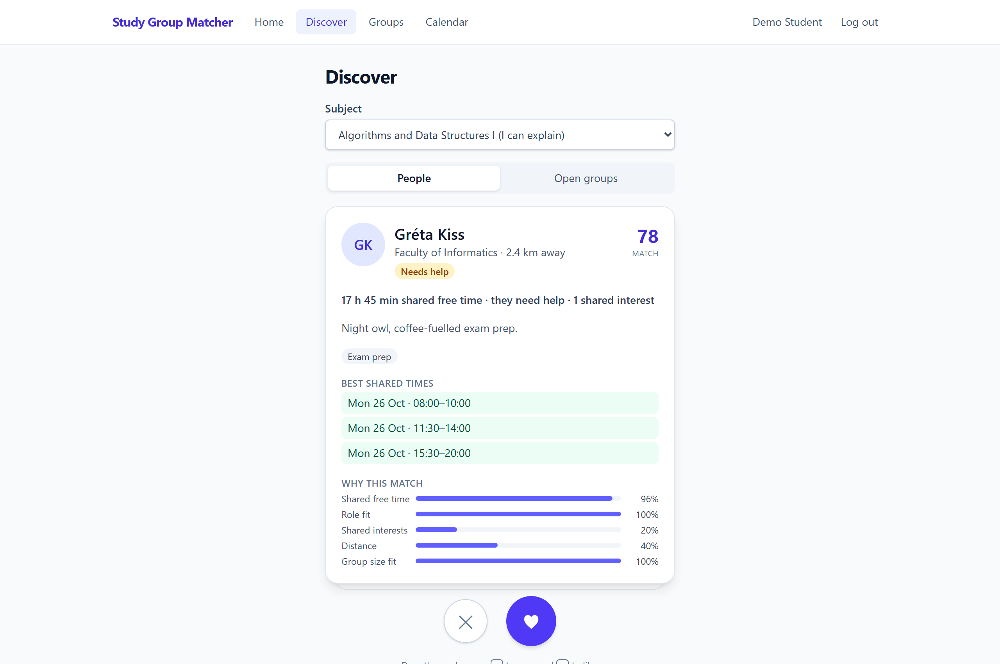
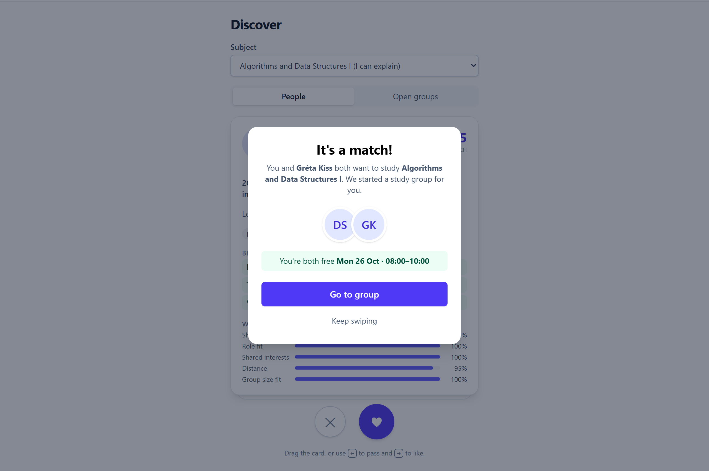
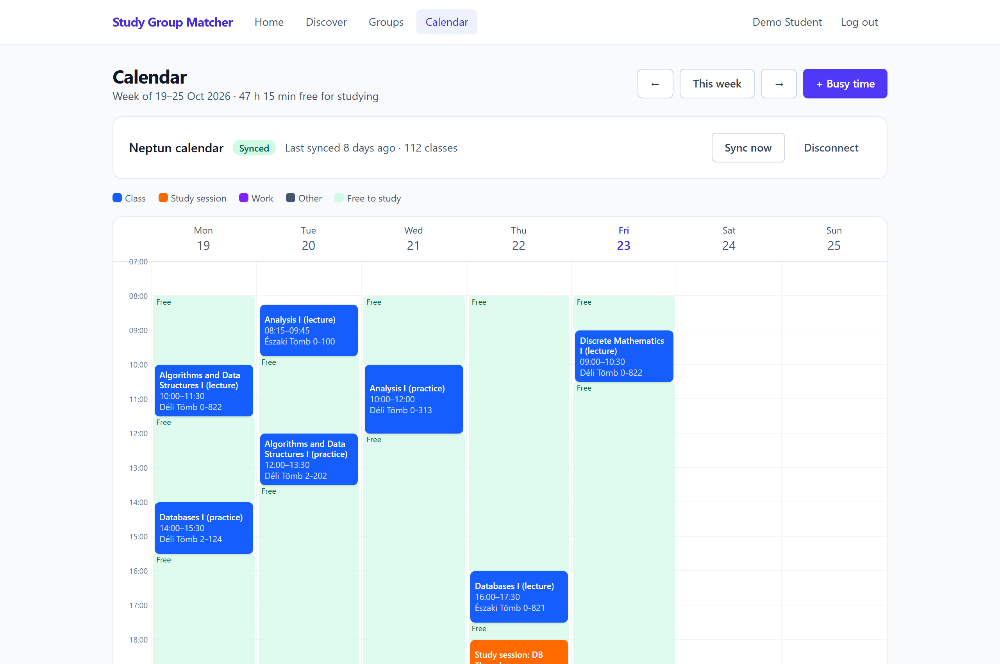
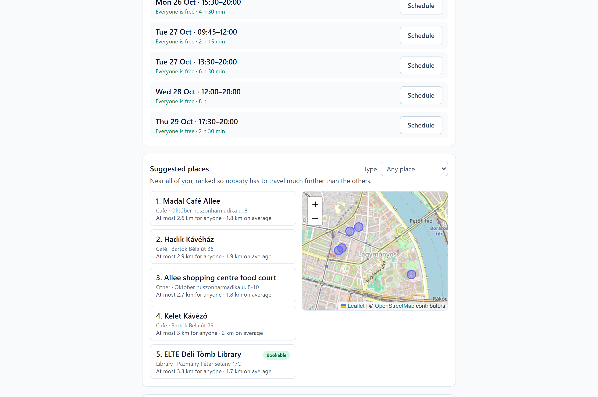
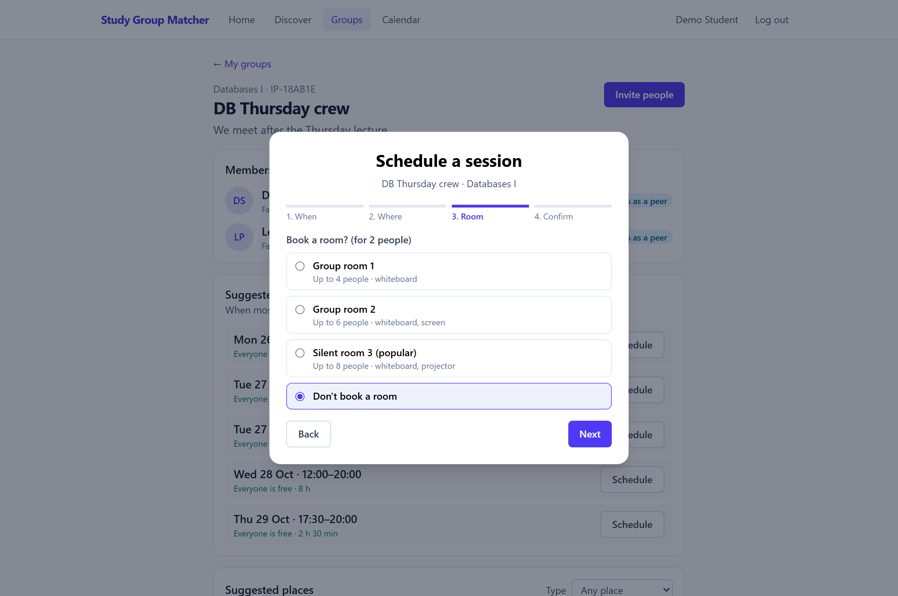
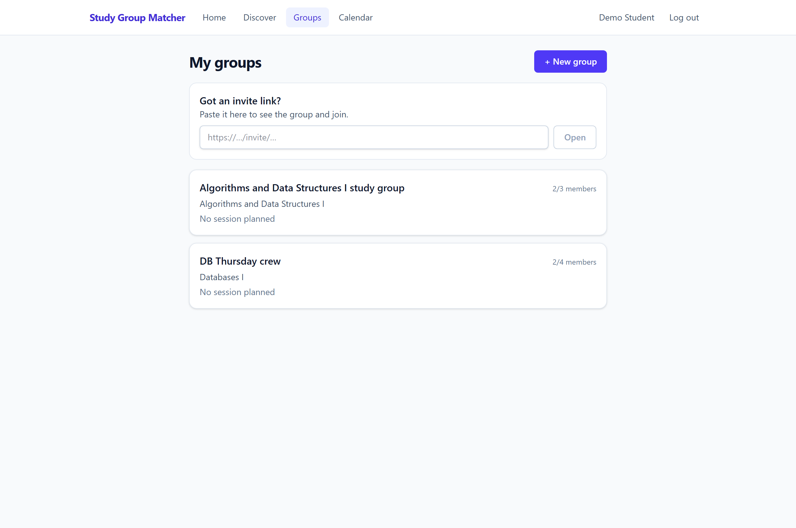

# Study Group Matcher 🎓

[](https://wisehackthenight.vercel.app)
[](https://nodejs.org/)
[](https://www.typescriptlang.org/)
[](https://react.dev/)
[](https://fastify.dev/)
[](https://www.prisma.io/)
[](https://www.postgresql.org/)

> **"Tinder for scheduling classes together."**  
> An intelligent peer-learning platform designed for university students. Study Group Matcher solves the hardest friction in university collaboration: finding compatible classmates whose schedules, subject needs, and physical locations actually align—then automatically booking campus rooms for study sessions.

---

## 🚀 Live Demo & Test Account

Experience the fully functional application running in production on Vercel:

- **Live URL:** [https://wisehackthenight.vercel.app](https://wisehackthenight.vercel.app)
- **Pre-Seeded Demo Account:**
  - **Email:** `demo@sgm.local`
  - **Password:** `password123`

*The demo account is pre-populated with active university subjects, real class timetables, matched peers, group chats, and bookable campus study rooms.*

---

## 🌟 Key Features

### 1. Smart Matching Algorithm & Swipe Deck
Find study partners who complement your academic strengths:
- **Tinder-Style Discovery:** Swipe right to Like or left to Pass on classmates studying the same subjects.
- **Transparent Compatibility Breakdown:** Every match candidate shows an overall score (0–100%) and a component breakdown:
  - **Shared Free Time (35%):** Calculates true overlapping minutes over the next 14 days based on calendar availability.
  - **Role Complementarity (25%):** Prioritizes complementary peer dynamics (`NEEDS_HELP` ↔ `CAN_EXPLAIN` = 1.0, `PEER` ↔ `PEER` = 0.7).
  - **Shared Academic Interests (15%):** Jaccard similarity across study goals (Exam Prep, Competitive Programming, Thesis, etc.).
  - **Geographic Proximity (15%):** Haversine distance calculation within your chosen radius.
  - **Group Size Fit (10%):** Ensures overlap in desired study group capacity (2–4 students).
- **Instant Mutual Matches:** When two students like each other, a match modal celebrates the connection and automatically spins up a study group.

### 2. Neptun Calendar Sync & Schedule Conflict Prevention
Never manually compare class timetables again:
- **One-Click iCal Integration:** Connect via public Neptun calendar subscription URL (`webcal://` or `https://`) or upload `.ics` timetable exports.
- **16-Week Horizon Expansion:** Class recurring rules (RRULE) are parsed into exact calendar event blocks with course codes and campus room assignments.
- **Dynamic Availability Computation:** Free study windows (e.g., Monday–Friday 08:00–20:00) minus busy lecture blocks and manual busy times. Calculated dynamically on read without stale data.
- **Anti-Conflict Protection:** Scheduled study sessions immediately mirror as busy calendar blocks for all participants to block future conflicts.

### 3. Fair Meetup Locations & Interactive Centroid Map
Fairness for everyone in the group:
- **Centroid Calculation:** Computes the mathematical geometric center of all members' home locations.
- **Fairness Ranking:** Venues (university libraries, campus study rooms, quiet cafés) are ranked by **maximum member distance** so no single student carries an unfair commute burden.
- **Interactive Leaflet Map:** Visualizes suggested study spots across the city with real-time distance metrics and venue types.

### 4. One-Click Room Booking & Session Scheduling
Move seamlessly from matching to studying:
- **Optimal Time Slot Suggestions:** Ranks the best shared free windows across all group members.
- **Direct Campus Room Reservation:** Built-in room booking provider supporting campus libraries, quiet study rooms, and whiteboard areas.
- **Calendar Synchronization:** Session bookings are confirmed, assigned a room, and synced directly to member calendars.

---

## 📸 Application Showcase

### Swipe & Discover Deck
*Evaluate candidates with transparent compatibility scoring, shared free time, role fit, and distance.*


### Mutual Match Celebration
*Instant notification and group creation upon mutual like.*


### Neptun Calendar & Weekly Schedule
*Live synchronization with university timetables, color-coded lectures, study sessions, and free study windows.*


### Fair Meetup Locations & Centroid Map
*Centroid-ranked venues ensuring equal travel distance for all group members with interactive Leaflet map.*


### Campus Room Booking & Session Scheduler
*Step-by-step wizard to pick shared free times, filter bookable library rooms, and reserve space.*


### Study Groups Hub
*Manage your active study groups, upcoming sessions, member roles, and shareable group invite links.*


---

## 🏗️ Architecture Overview

The repository is structured as a typed monorepo using **pnpm workspaces** and per-package lockfiles to eliminate dependency conflicts:

```
WiseHackTheNight/
├── apps/
│   ├── api/                   # Fastify 5 REST API & backend domain modules
│   └── web/                   # React 19 / 18 SPA built with Vite & Tailwind CSS
├── packages/
│   ├── contracts/             # OpenAPI 3.1 contract & generated TypeScript types
│   └── integrations/          # Neptun iCal parser, Geo centroid math, Room booking
├── contracts/
│   └── openapi.yaml           # Single source of truth API specification
├── docs/
│   ├── ARCHITECTURE.md        # Comprehensive technical architecture document
│   └── screenshots/           # High-resolution application UI screenshots
└── scripts/
    └── build-vercel.js        # Serverless bundle builder for Vercel deployment
```

### Technology Stack

| Layer | Technologies | Purpose |
|---|---|---|
| **Frontend** | React 19 / 18, Vite, TypeScript, Tailwind CSS, TanStack Query, React Router v7 | Responsive UI with optimistic updates and client-side caching. |
| **Mapping & Motion** | Leaflet, `react-leaflet`, Framer Motion | Smooth swipe gestures and interactive OpenStreetMap venue explorer. |
| **Mock Engine** | Mock Service Worker (MSW) | Full contract-accurate offline mock backend for fast frontend development and E2E testing. |
| **Backend** | Fastify 5, `@fastify/autoload`, `@fastify/jwt`, Zod, argon2 | High-throughput, strictly validated REST API with modular route plugins. |
| **Database & ORM** | PostgreSQL 16, Prisma 6 (multi-file schema) | Relational data persistence with strict type safety and schema modularity. |
| **Integrations** | `node-ical`, `luxon` (Europe/Budapest), Nominatim (OSM) | Calendar timetable ingestion, timezone math, and fair distance geocoding. |
| **Contract** | OpenAPI 3.1, `openapi-typescript`, `openapi-fetch` | End-to-end type safety shared across backend and frontend. |
| **Testing** | Vitest, Playwright | Comprehensive unit, integration, and cross-device browser E2E test suites. |

---

## 🛠️ Getting Started Locally

### Prerequisites
- **Node.js:** `>= 22.0.0`
- **pnpm:** `>= 9.0.0`
- **Docker:** (Optional, for running local PostgreSQL 16)

### 1. Clone & Install Dependencies
```bash
git clone https://github.com/mrackegithub/WiseHackTheNight.git
cd WiseHackTheNight
pnpm install
```

### 2. Environment Configuration
Create environment files from the provided templates:
```bash
cp apps/api/.env.example apps/api/.env
cp apps/web/.env.example apps/web/.env
```

### 3. Database Setup (PostgreSQL)
Start the PostgreSQL container via Docker Compose:
```bash
pnpm db:up
```
*(If running Postgres natively without Docker, ensure user `sgm` / password `sgm` / database `sgm` exists on port 5432).*

Apply database schema migrations:
```bash
pnpm --filter @sgm/api exec prisma migrate dev
```

Seed the database with realistic Budapest student data (200 users, 40 courses, 25 locations, and Neptun timetables):
```bash
pnpm db:seed
```

### 4. Run the Development Server
Launch both the backend API and frontend client concurrently:
```bash
pnpm dev
```
- **Web Application:** [http://localhost:5173](http://localhost:5173)
- **API Health Check:** [http://localhost:4000/api/v1/health](http://localhost:4000/api/v1/health)

### Running Frontend Standalone (Zero-Config MSW Mode)
You can also run the frontend entirely standalone without running Docker or PostgreSQL:
```bash
pnpm --filter @sgm/web dev
```
*(MSW intercepts network calls and serves a complete in-memory mock database pre-seeded with test users, calendar events, and groups).*

---

## 🧪 Testing & Verification

The project includes thorough verification suites across unit, integration, and end-to-end layers:

```bash
# Run TypeScript typechecks across all monorepo packages
pnpm typecheck

# Run unit and integration tests (Vitest)
pnpm --filter @sgm/integrations test
pnpm --filter @sgm/web test

# Run full Playwright browser end-to-end tests (desktop and mobile)
pnpm --filter @sgm/web e2e

# Run contract validation & type generation
pnpm contract:lint
pnpm contract:gen

# Test production build bundle (simulates Vercel build)
pnpm run vercel-build
```

---

## 👥 Demo Credentials Reference

| Role | Email | Password | Notes |
|---|---|---|---|
| **Demo Student** | `demo@sgm.local` | `password123` | Pre-seeded with courses (Algorithms, Databases, Analysis), Neptun calendar, and group memberships. |
| **Seeded Students** | `student{N}@sgm.local` (e.g. `student1@sgm.local`) | `password123` | 200 diverse students across Budapest universities for candidate discovery. |

---

## 📄 License

This project was built for **Wise Hack the Night 2026** and is released under the [MIT License](LICENSE).
